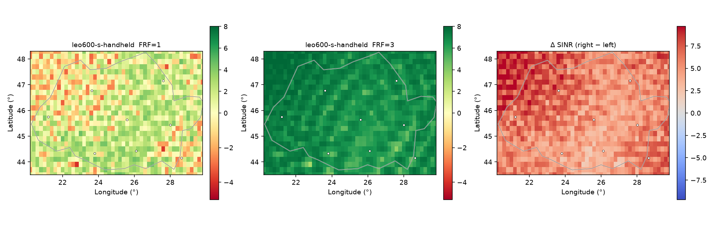

# ntn-coverage

[](https://www.python.org/)
[](LICENSE)
[](https://pytest.org/)
[](https://docs.astral.sh/ruff/)

Downlink SINR for NTN using 3GPP TR 38.811 (channel) and TR 38.821 Set-1 (RF, hex beams, reuse). Not noise-limited SNR: intra- and inter-satellite co-channel interference, then P(cover) and 38.214-style MCS.

```bash
uv venv --python 3.12
uv pip install --system-certs -e ".[dev]"
```

```bash
ntn-coverage point --lat 44.4268 --lon 26.1025
ntn-coverage pass --lat 44.4268 --lon 26.1025 --minutes 20
ntn-coverage map --region romania --reuse 3
ntn-coverage workbench
```

`point` prints a one-line link budget (`--json` for the full record). `map` also writes `.npz` / `.csv` next to the PNG. GUI is `http://127.0.0.1:8765/` — Compute snapshot, click the map for the 19-beam cluster, Pass for elev/SINR vs time.

## Romania, LEO 600 km, S-band handheld, 0.2°

Same snapshot, same C/N (8.79 dB). Only FRF changes.

| | FRF=1 | FRF=3 |
| --- | ---: | ---: |
| SINR ≥ 0 dB | 68.4% | 100% |
| median SINR | 1.26 dB | 6.99 dB |
| mean rate (30 MHz) | 32.1 Mbps | 63.3 Mbps |



Interference-limited. Calibration vs TR 38.821 SC6 (LEO-600 Ka VSAT, 30°): FSPL 179.099 vs 179.1 dB, CNR 8.23 vs 8.5 dB.

## Engine

Walker / GEO / TLE → WGS-84 → TR 38.811 LOS/clutter/gases, ITU-R P.838/P.618 rain → Bessel aperture, 19-beam hex cluster, FRF 1 or 3 → SINR, P(cover), MCS.

Each satellite lights a fixed 19-beam cluster. The serving satellite's cluster is centred on the user's beam (wrap-around equivalent); with `exclusive` coordination the other satellites keep theirs at nadir, with `uncoordinated` they also centre on the user. A pixel's SINR depends only on its location, so `point` and `map` agree and the grid extent does not change results. Grids are processed in chunks against visible satellites only, so large regions stay within memory.

Default constellation is Walker 360/18/1 @ 600 km. `starlink-s-handheld` is 72×22 @ 550 km geometry with **Set-1 S-band RF**, not operator EIRP.

```python
from ntn_coverage import get_scenario, predict_point, predict_coverage

s = get_scenario("leo600-s-handheld").with_reuse(3)
print(predict_point(44.43, 26.10, s).sinr_db)
```

Flags: `--reuse 1|3`, `--antenna cellular|steered|nadir`, `--coordination exclusive|uncoordinated`, `--environment mixed`, `--rain`, `--indoor`, `--tle`.

Availability mode samples one Walker period. `coverage_fraction` is the fraction of time above the SINR threshold, and `ever_covered_fraction` is the share of pixels that clear it at least once. In that mode SINR, C/N and elevation are means while a satellite is serving; throughput and P(cover) count outages as zero. Doppler uses the Earth-fixed satellite velocity, so a fixed terminal on a GEO link is about 0 Hz.

## Limitations

- Downlink only. No uplink budget, scheduler, or handover.
- `mixed` is urban inside a built-in list of metro circles (Romanian cities, plus capitals and large cities elsewhere) and rural outside them. There is no land-cover raster.
- `--rain` is the fade while rain is falling at that mm/h. The rainy path is capped at the depth of the rain layer. The annual level exceeded 0.01% of a year needs an ITU-R P.837 climate map, which is not included.
- `--indoor` adds a flat 20 dB. The TR 38.811 outdoor-to-indoor low-loss and high-loss models are not implemented.
- Gaseous loss is a zenith lookup divided by sin(elevation). Scintillation is the TR 38.821 latitude rule plus a small tropospheric term.
- Throughput uses TS 38.214 spectral efficiencies at approximate SINR switching points, with 14% overhead.
- Each visible satellite contributes a 19-beam cluster. Beams outside that cluster are omitted.
- TLE states are rotated by GMST at the element epoch. Polar motion and the equation of the equinoxes are omitted.
- A grid above 150 000 points, or a step below 0.02°, is rejected.
- `starlink-s-handheld` is the 72×22 geometry at 550 km with Set-1 S-band RF, not the operator link budget.

```bash
python -m pytest
ruff check src tests
```

MIT.
